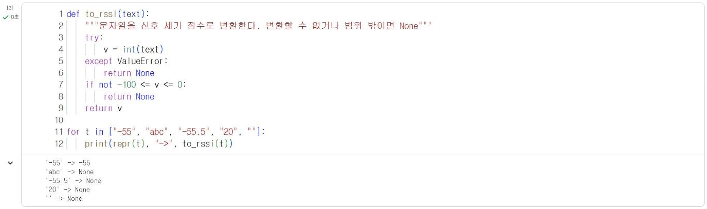
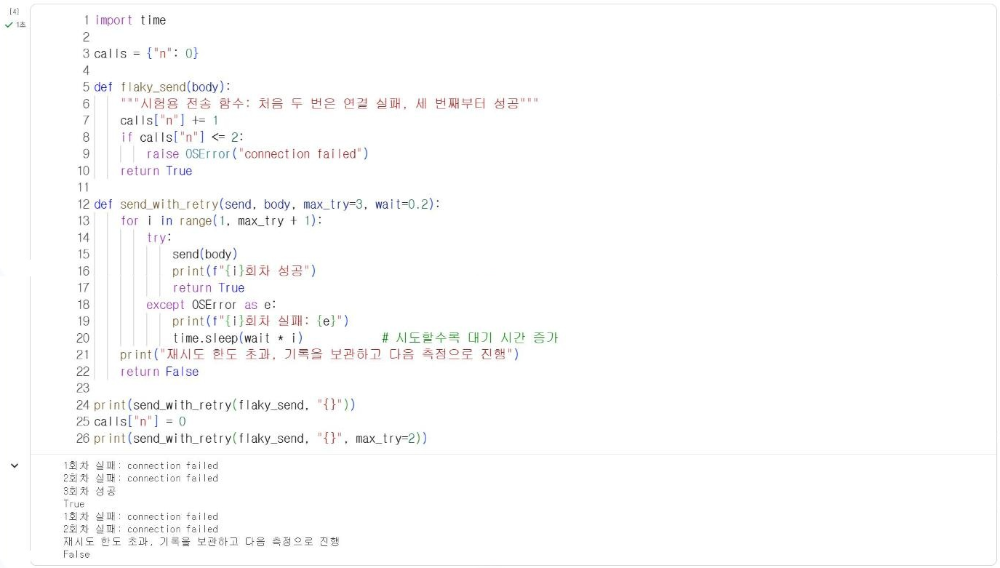

# 15.2 예외 처리

시연 중 Wi-Fi가 잠시 끊기거나, 서버가 응답하지 않거나, 센서가 범위 밖의 값을 반환할 수 있다. 예외(exception)는 프로그램 실행 중 발생하는 이런 오류 상황이다. 예외를 처리하지 않으면 프로그램이 정지하므로, 예상되는 예외는 코드로 대응한다. 8.1절의 기기 프로그램과 13.4절의 `safe_report`에서 이미 예외 처리를 사용했다.

## try-except

```python
def to_rssi(text):
    """문자열을 신호 세기 정수로 변환한다. 변환할 수 없거나 범위 밖이면 None"""
    try:
        v = int(text)
    except ValueError:
        return None
    if not -100 <= v <= 0:
        return None
    return v

for t in ["-55", "abc", "-55.5", "20", ""]:
    print(repr(t), "->", to_rssi(t))
```

**실행 결과**

```text
'-55' -> -55
'abc' -> None
'-55.5' -> None
'20' -> None
'' -> None
```

<figure markdown="span">
  
  <figcaption>그림 15-? Colab에서 실행한 입력 오류 처리</figcaption>
</figure>

| 구문 | 의미 |
|---|---|
| `try:` | 예외가 발생할 수 있는 코드 |
| `except ValueError:` | 지정한 종류의 예외가 발생하면 실행 |
| `except Exception:` | 모든 일반 예외에 대응(원인을 숨기므로 꼭 필요한 곳에만 사용) |
| `finally:` | 예외 발생 여부와 관계없이 마지막에 항상 실행(8.2절 `s.close()`) |

`int("-55.5")`처럼 정수로 변환할 수 없는 문자열은 `ValueError`를 발생시킨다. 범위 검사는 예외가 아니라 조건문으로 처리했다. 형식 오류는 `try`로, 값의 범위는 `if`로 구분해 처리한다.

| 예외 | 발생 상황 | 대응 |
|---|---|---|
| `ValueError` | 형식이 맞지 않는 값의 변환 | 해당 값 무시, 기록에서 제외 |
| `KeyError` | 딕셔너리에 없는 키 조회 | 기본값 사용(`d.get(key, 기본값)`) |
| `TimeoutError`, `OSError` | 네트워크 응답 지연·연결 실패 | 재시도, 재접속 |
| `ZeroDivisionError` | 0으로 나누기 | 자료 개수 확인 후 계산 |

## 재시도 횟수 제한

통신 실패는 잠시 후 다시 시도하면 성공하는 경우가 많다. 그러나 무한히 재시도하면 서버가 완전히 멈춘 상황에서 프로그램이 다음 작업으로 넘어가지 못한다. 재시도는 횟수를 제한하고, 시도 사이에 대기 시간을 둔다.

다음 코드는 처음 두 번은 실패하고 세 번째에 성공하는 가상의 전송 함수로 재시도 구조를 시험한다.

```python
import time

calls = {"n": 0}

def flaky_send(body):
    """시험용 전송 함수: 처음 두 번은 연결 실패, 세 번째부터 성공"""
    calls["n"] += 1
    if calls["n"] <= 2:
        raise OSError("connection failed")
    return True

def send_with_retry(send, body, max_try=3, wait=0.2):
    for i in range(1, max_try + 1):
        try:
            send(body)
            print(f"{i}회차 성공")
            return True
        except OSError as e:
            print(f"{i}회차 실패: {e}")
            time.sleep(wait * i)            # 시도할수록 대기 시간 증가
    print("재시도 한도 초과, 기록을 보관하고 다음 측정으로 진행")
    return False

print(send_with_retry(flaky_send, "{}"))
calls["n"] = 0
print(send_with_retry(flaky_send, "{}", max_try=2))
```

**실행 결과**

```text
1회차 실패: connection failed
2회차 실패: connection failed
3회차 성공
True
1회차 실패: connection failed
2회차 실패: connection failed
재시도 한도 초과, 기록을 보관하고 다음 측정으로 진행
False
```

<figure markdown="span">
  
  <figcaption>그림 15-? Colab에서 실행한 재시도 횟수 제한</figcaption>
</figure>

`except OSError as e`의 `e`는 발생한 예외 객체이며, 출력하면 오류 메시지가 표시된다. `time.sleep(wait * i)`는 1회차 실패 후 0.2초, 2회차 실패 후 0.4초를 기다린다. 시도할수록 대기 시간을 늘리면 일시적으로 혼잡한 서버에 요청이 몰리지 않는다. 최대 2회로 제한한 두 번째 실행은 한도를 초과해 `False`를 반환하고 다음 작업으로 넘어간다.

## 실패한 기록의 처리

| 방법 | 내용 | 적합한 상황 |
|---|---|---|
| 폐기 | 실패한 측정값을 버림 | 측정이 자주 반복되어 일부 손실이 허용될 때(8.2절 측정 노드) |
| 보관 후 재전송 | 리스트에 보관했다가 연결이 회복되면 전송 | 모든 기록이 필요할 때 |
| 대체 보고 | 다른 방법으로 결과 전달 | AI 보고 실패 시 요약 표(13.4절) |

## 확인 문제

1. `to_rssi`가 `" -55 "`(앞뒤 공백)과 `None`을 입력받으면 어떻게 동작하는지 확인하고, 필요하면 수정하시오.
2. `send_with_retry`를 수정해 실패한 `body`를 리스트에 보관하고, 다음 호출에서 먼저 재전송하도록 작성하시오.
3. 본인 팀 프로젝트에서 발생할 수 있는 예외 세 가지와 각각의 대응 방법을 표로 정리하시오.
