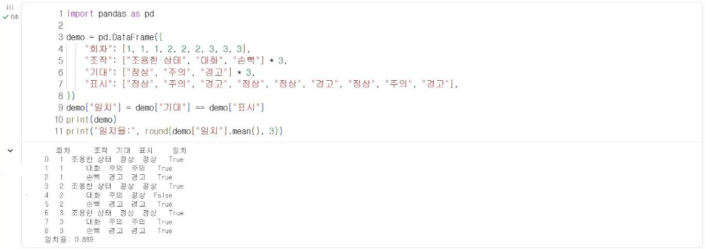
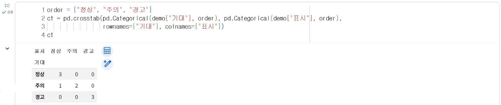
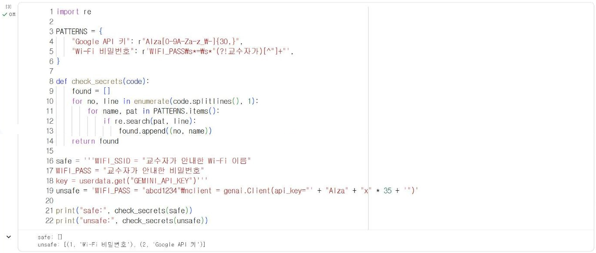

# 16.2 시연 점검 기준

시연 결과는 동작, 판정 근거, AI 출력 검증, 코드의 네 영역으로 점검한다. 각 영역은 시연을 보는 사람이 같은 기준으로 확인할 수 있도록 확인 방법을 정해 둔다. 이 절의 기준은 팀이 시연 전에 스스로 점검하는 목록으로도 사용한다.

## 점검 영역

| 영역 | 점검 항목 | 확인 방법 |
|---|---|---|
| 동작 | 측정 → 판정 → 표시 → 전송 → 기록의 연결 | 실시간 시연, 서버 `/summary` 건수 증가 |
| 동작 | 조작별 표시 결과 | 시연 기록 대조(아래 코드) |
| 판정 근거 | 임계값 또는 모델의 근거 | 분위수 산출 과정(7.1절) 또는 정확도·교차 평가 결과(11.4·12.3절) |
| 판정 근거 | 오류 우선순위 | 오경보·미검출 중 우선 감소 대상과 기준 조정 근거(7.3절) |
| AI 출력 검증 | 보고 문장의 수치 | `check_report` 결과(13.4절) |
| AI 출력 검증 | AI 불통 시 대체 보고 | 대체 보고 시연 또는 설명 |
| 코드 | 구조와 예외 처리 | 함수 분리, `try`·`except`, 재시도 횟수 제한(15.2절) |
| 코드 | 비밀 값 제거 | 제출 코드 점검(아래 코드) |

| 수준 | 기준 |
|---|---|
| 충족 | 확인 방법으로 항목을 모두 확인함 |
| 부분 충족 | 일부만 확인되거나, 대체 시연으로 확인함 |
| 미충족 | 확인할 수 없음 |

## 시연 기록 대조

실시간 시연에서 조작마다 기대한 표시와 실제 표시를 기록하고 일치 여부를 집계한다. 다음은 소음 신호등 팀이 15.3절의 조작 3가지를 3회 반복한 시연 연습 기록 예시다.

```python
import pandas as pd

demo = pd.DataFrame({
    "회차": [1, 1, 1, 2, 2, 2, 3, 3, 3],
    "조작": ["조용한 상태", "대화", "손뼉"] * 3,
    "기대": ["정상", "주의", "경고"] * 3,
    "표시": ["정상", "주의", "경고", "정상", "정상", "경고", "정상", "주의", "경고"],
})
demo["일치"] = demo["기대"] == demo["표시"]
print(demo)
print("일치율:", round(demo["일치"].mean(), 3))
```

**실행 결과**

```text
   회차      조작  기대  표시     일치
0   1  조용한 상태  정상  정상   True
1   1      대화  주의  주의   True
2   1      손뼉  경고  경고   True
3   2  조용한 상태  정상  정상   True
4   2      대화  주의  정상  False
5   2      손뼉  경고  경고   True
6   3  조용한 상태  정상  정상   True
7   3      대화  주의  주의   True
8   3      손뼉  경고  경고   True
일치율: 0.889
```

<figure markdown="span">
  
  <figcaption>그림 16-? Colab에서 실행한 시연 기록 대조(예시 기록)</figcaption>
</figure>

기대와 표시가 다른 조작을 교차표로 확인하면 어느 단계에서 판정이 어긋났는지 알 수 있다.

```python
order = ["정상", "주의", "경고"]
ct = pd.crosstab(pd.Categorical(demo["기대"], order), pd.Categorical(demo["표시"], order),
                 rownames=["기대"], colnames=["표시"])
ct
```

**실행 결과**

```text
표시  정상  주의  경고
기대            
정상   3   0   0
주의   1   2   0
경고   0   0   3
```

<figure markdown="span">
  
  <figcaption>그림 16-? 기대 단계와 표시 단계의 교차표</figcaption>
</figure>

예시 기록에서는 2회차의 「대화」 조작이 주의가 아니라 정상으로 표시되었다. 대화 소리가 주의 임계값 근처에 있으면 말하는 크기에 따라 판정이 바뀐다. 이 경우 시연 조작을 임계값에서 충분히 떨어진 상황으로 바꾸거나, 임계값 근처 값의 판정이 불안정하다는 사실을 시연에서 함께 설명한다. 시연 결과를 임계값 조정의 근거로 사용할 때는 시연 기록이 아니라 측정 기록 전체로 다시 산출한다(7.1절).

## 제출 코드 점검

제출하거나 공개하는 코드에는 API 키와 Wi-Fi 비밀번호가 포함되지 않아야 한다(8.2·13.1절). 다음 함수는 코드 문자열에서 Google API 키 형식(`AIza`로 시작하는 문자열)과 비밀번호가 기입된 `WIFI_PASS` 줄을 찾는다.

```python
import re

PATTERNS = {
    "Google API 키": r"AIza[0-9A-Za-z_\-]{30,}",
    "Wi-Fi 비밀번호": r'WIFI_PASS\s*=\s*"(?!교수자가)[^"]+"',
}

def check_secrets(code):
    found = []
    for no, line in enumerate(code.splitlines(), 1):
        for name, pat in PATTERNS.items():
            if re.search(pat, line):
                found.append((no, name))
    return found

safe = '''WIFI_SSID = "교수자가 안내한 Wi-Fi 이름"
WIFI_PASS = "교수자가 안내한 비밀번호"
key = userdata.get("GEMINI_API_KEY")'''
unsafe = 'WIFI_PASS = "abcd1234"\nclient = genai.Client(api_key="' + "AIza" + "x" * 35 + '")'

print("safe:", check_secrets(safe))
print("unsafe:", check_secrets(unsafe))
```

**실행 결과**

```text
safe: []
unsafe: [(1, 'Wi-Fi 비밀번호'), (2, 'Google API 키')]
```

<figure markdown="span">
  
  <figcaption>그림 16-? Colab에서 실행한 비밀 값 점검</figcaption>
</figure>

`(?!교수자가)`는 바로 뒤에 「교수자가」가 오지 않을 때만 일치하도록 지정하는 정규식 문법이다. 교재의 자리 표시 문구는 통과시키고, 실제 비밀번호가 기입된 줄만 찾는다. `unsafe`의 API 키는 형식만 맞춘 가짜 문자열이다. 팀 코드 파일을 점검할 때는 다음과 같이 폴더의 `.py` 파일을 모두 읽어 같은 함수에 입력한다.

```python
import glob

for path in glob.glob("*.py"):
    result = check_secrets(open(path, encoding="utf-8").read())
    print(path, result if result else "이상 없음")
```

이 코드는 팀 코드 파일이 있는 폴더에서 실행한다. 이 점검은 정해진 형식만 찾으므로 모든 비밀 값을 찾지는 못한다. API 키는 13.1절의 방법으로 Colab 보안 비밀이나 환경 변수에 보관하고, 코드에는 처음부터 기입하지 않도록 한다.

## 확인 문제

1. 본인 팀의 시연 연습 기록을 `demo` 형식으로 작성하고 일치율과 교차표를 산출하시오.
2. `PATTERNS`에 서버 PC의 IP 주소가 기입된 `SERVER_IP` 줄을 찾는 정규식을 추가하시오.
3. 점검 영역 중 본인 팀이 「부분 충족」 이하로 예상하는 항목과 보완 계획을 작성하시오.
