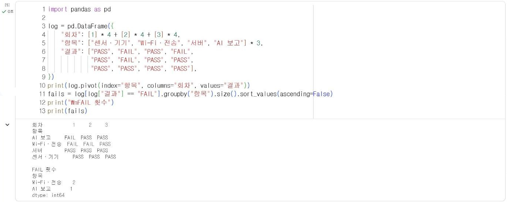

# 16.3 회고와 개선 과제

회고(retrospective)는 프로젝트가 끝난 뒤 진행 과정을 되짚어 유지할 점, 문제점, 다음에 시도할 개선 사항을 정리하는 활동이다. 시연에서 드러난 문제와 15.1절 통합 점검 기록을 근거로 개선 과제의 우선순위를 정하고, 재현 측정으로 만든 시스템을 실제 현장에 적용하려면 무엇이 필요한지 정리한다.

## 회고 양식

이 과목에서는 KPT 방식으로 회고한다. KPT는 유지할 점(Keep), 문제점(Problem), 시도할 개선 사항(Try)의 머리글자다. 각 항목은 근거가 되는 기록이나 수치와 함께 작성한다.

| 구분 | 질문 | 작성 예 |
|---|---|---|
| Keep | 잘 동작해서 유지할 것은 무엇인가 | 서버 재생 시험으로 수정 후 동작을 매번 확인함(14.4절) |
| Problem | 문제가 발생한 곳은 어디이며 근거는 무엇인가 | Wi-Fi·전송 단계 FAIL 2회(점검 기록) |
| Try | 다음에 무엇을 바꿀 것인가 | 실패한 측정값 보관 후 재전송(15.2절 확인 문제 2) |

## 점검 기록 집계

15.1절의 점검 기록을 표로 정리하면 실패가 반복된 연결 지점을 확인할 수 있다. 다음은 통합 점검을 3회 진행한 팀의 기록 예시다.

```python
import pandas as pd

log = pd.DataFrame({
    "회차": [1] * 4 + [2] * 4 + [3] * 4,
    "항목": ["센서·기기", "Wi-Fi·전송", "서버", "AI 보고"] * 3,
    "결과": ["PASS", "FAIL", "PASS", "FAIL",
             "PASS", "FAIL", "PASS", "PASS",
             "PASS", "PASS", "PASS", "PASS"],
})
print(log.pivot(index="항목", columns="회차", values="결과"))
fails = log[log["결과"] == "FAIL"].groupby("항목").size().sort_values(ascending=False)
print("\nFAIL 횟수")
print(fails)
```

**실행 결과**

```text
회차           1     2     3
항목                        
AI 보고     FAIL  PASS  PASS
Wi-Fi·전송  FAIL  FAIL  PASS
서버        PASS  PASS  PASS
센서·기기     PASS  PASS  PASS

FAIL 횟수
항목
Wi-Fi·전송    2
AI 보고       1
dtype: int64
```

<figure markdown="span">
  
  <figcaption>그림 16-4 Colab에서 실행한 통합 점검 기록 집계(예시 기록)</figcaption>
</figure>

`pivot`은 긴 형식의 기록을 항목×회차 표로 재배치한다. 예시 기록에서는 Wi-Fi·전송 단계가 두 번 실패해 개선 과제의 1순위가 된다. 3회차에 모두 통과했더라도, 실패 원인과 조치를 기록해 두지 않으면 시연 당일 같은 문제가 다시 발생했을 때 대응할 수 없다.

## 개선 과제 우선순위

개선 과제는 영향 범위와 발생 빈도로 우선순위를 정한다.

| 과제 | 영향 범위 | 발생 빈도 | 우선순위 |
|---|---|---|---|
| 전송 실패 시 측정값 손실 | 서버 기록·요약·보고 전체 | 높음(FAIL 2회) | 1 |
| AI 보고 수치 불일치 | 보고 문장 | 낮음(FAIL 1회) | 2 |
| | | | |

## 현장 적용 과제

프로젝트는 학교나 가정에서 현장 상황을 재현해 측정했다(12.4절). 실제 현장에서 사용하려면 다음 조건을 추가로 확인해야 한다.

| 항목 | 확인 내용 |
|---|---|
| 회사 승인 | 기기 설치, 회사 망 연결, 측정 자료 보관 승인 |
| 측정 기간 | 재현 측정보다 긴 기간의 측정으로 시간대·요일별 변동 확인 |
| 기준 재산출 | 현장 측정 자료로 임계값 또는 모델을 다시 산출 |
| 일반화 확인 | 다른 위치·다른 사용자 자료로 교차 평가(12.3절) |
| 운영 | 배터리 교체, 서버 상시 실행, 장애 시 대체 절차 |
| 보안과 개인정보 | 비밀 값 관리, 사람의 위치·행동이 기록되지 않는지 확인 |

<!-- PHOTO: ch16_photo_retro — KPT 회고 결과 예시(화이트보드 또는 양식 작성 예), 학생 얼굴·이름 제외 -->

## 확인 문제

1. 본인 팀의 KPT 회고를 항목마다 근거와 함께 작성하시오.
2. 본인 팀의 점검 기록을 `log` 형식으로 정리하고 FAIL 횟수가 가장 많은 항목의 원인과 조치를 작성하시오.
3. 본인 팀 시스템을 실제 직무 현장에 적용할 때 가장 먼저 확인해야 할 항목 두 가지와 이유를 작성하시오.
